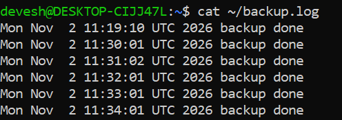
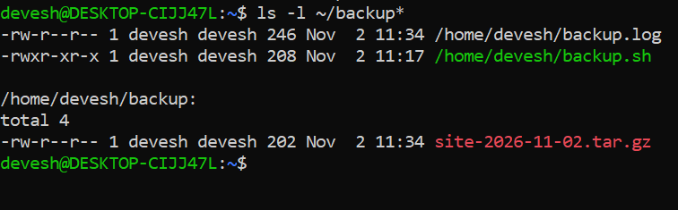

# Linux Automated Backup & Monitoring

Bash scripts and cron jobs for automated backups and basic system monitoring on Ubuntu (WSL).

## Tools
Ubuntu (WSL), Bash, cron, nginx

## What it does
- **backup.sh**: creates a compressed backup (`site-YYYY-MM-DD.tar.gz`) and logs it to `backup.log`. Scheduled daily at 2:00 AM (`0 2 * * *`).
- **moniter.sh**: logs disk and memory usage and writes an `ALERT` if nginx is not running. Runs every 5 minutes (`*/5 * * * *`).

## Screenshots
### Cron jobs

### Monitoring log (with nginx down alert)

### Backup log

### Backup files

## Commands used
`crontab -e`, `crontab -l`, `chmod +x`, `df`, `free`, `awk`, `pgrep`, `tar`, `tail`, `cat`

## Testing
- Verified cron auto-runs through log timestamps
- Stopped nginx (`sudo service nginx stop`) to confirm the `ALERT nginx down` entry

## Note
Tested on WSL, where cron runs only while WSL is running. On a real server it runs continuously.
